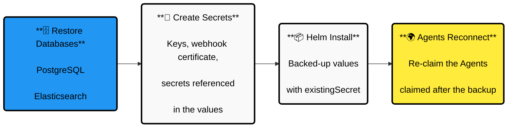
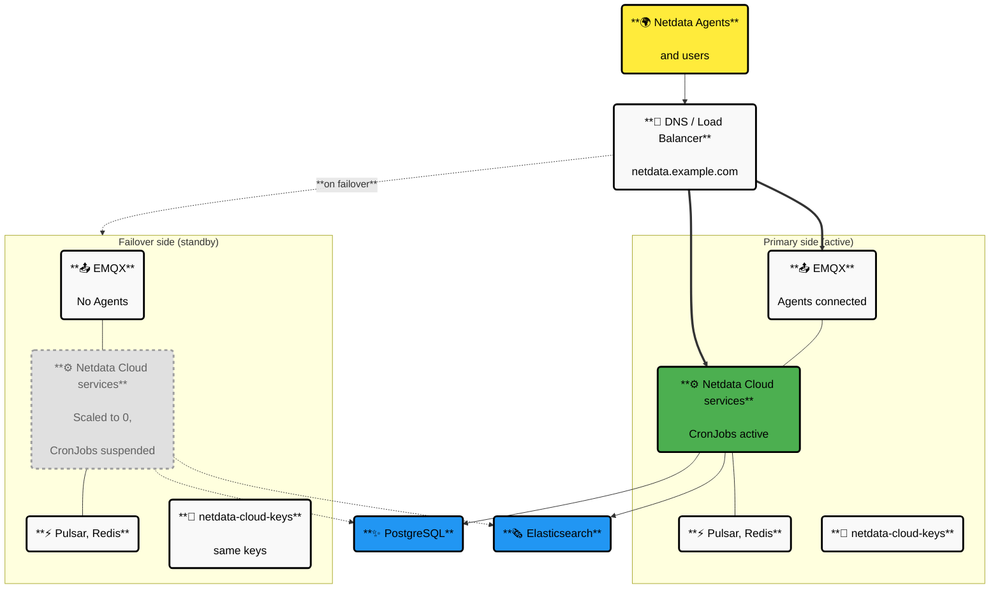
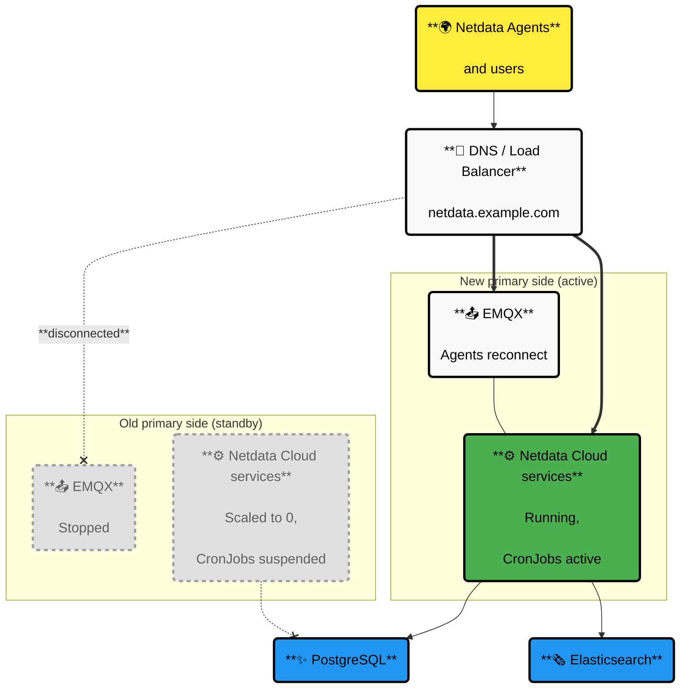

# Netdata Cloud On-Prem High Availability and Disaster Recovery

This guide shows you how to **back up and restore** your Netdata Cloud On-Prem installation and how to run it in an **active/passive setup**, where a second installation is ready to take over when the first one fails.

:::note

This guide requires the `netdata-cloud-onprem` Helm chart **version 2.7.0 or newer**. If you run an older version, upgrade it first.

:::

## Where Your Data Lives

Knowing where the state is kept tells you what needs to be backed up and what can simply be reinstalled.

| Component                         | What It Keeps                                                                                     | State                               |
| --------------------------------- | ------------------------------------------------------------------------------------------------- | ----------------------------------- |
| **Netdata Cloud services**        | Nothing, every microservice is stateless                                                          | None                                |
| **PostgreSQL**                    | Users, spaces, rooms, agents, nodes, chart contexts, alerts synced with the Agents, settings      | **Persistent**                      |
| **Elasticsearch**                 | Feed events triggered by the actions in Netdata Cloud On-Prem and by the Agents                   | **Persistent**                      |
| **Pulsar, EMQX**                  | Messages passed between the Agents and the Netdata Cloud services, and between the services       | In transit only\*                   |
| **Redis**                         | Cache that speeds up some operations, derived from the PostgreSQL state                          | Disposable                          |
| **Keys**                          | Keys used to sign tokens and **encrypt some of the database entries**                             | **Persistent**, not in `values.yaml` |

\* Notifications and feed events queued at the moment of failover are lost.

:::warning

**The keys are as important as the database.** Some database entries are encrypted with them, so **a database backup without the matching keys cannot be restored**. Losing or changing the keys results in data loss.

By default, the keys are generated randomly on the first installation into the `netdata-cloud-common` secret. You can also deliver them yourself with `global.autogeneratedSecrets.secretBased.existingSecret`. **In both cases you must back them up.**

:::

## Backup and Restore

### What to Back Up

| What                                     | How                                                                                                                                                       | Required                                                        |
| ---------------------------------------- | --------------------------------------------------------------------------------------------------------------------------------------------------------- | --------------------------------------------------------------- |
| **PostgreSQL**                           | Your database backup tools, for example `pg_dump`, volume snapshots or point-in-time recovery of your provider                                            | **Yes**                                                         |
| **Elasticsearch**                        | [Elasticsearch snapshots](https://www.elastic.co/guide/en/elasticsearch/reference/current/snapshot-restore.html)                                         | Recommended, without it you lose the history of feed events     |
| **Helm values**                          | `helm get values -n netdata-cloud netdata-cloud-onprem -o yaml`                                                                                            | **Yes**                                                         |
| **Keys**                                 | See [Move the Keys to Your Own Secret](#move-the-keys-to-your-own-secret)                                                                                 | **Yes**                                                         |
| **Webhook TLS certificate**              | The `cloud-notifications-dispatcher-service-webhook-tls` secret, or the secret set in `cloud_notifications_dispatcher_service.webhookCertificate.secretBased.existingSecret` | Only when your webhook receivers verify the certificate         |
| **Secrets referenced in the Helm values** | License, database credentials, SSO, SMTP and ingress TLS secrets referenced by the `existingSecret` options are not part of the values                    | **Yes**, or recreate them from your secret store                |
| **Redis, Pulsar, EMQX**                  | Not needed                                                                                                                                                | No                                                              |

:::warning

**The keys must come from the same installation as the database backup.** Keys from a different installation cannot decrypt the data.

:::

### Move the Keys to Your Own Secret

We recommend moving the keys to a secret managed by you **before you ever need a restore**. You then back up and restore a single secret, which you can keep in your secret store (for example Vault or External Secrets), and your installation is ready for the [active/passive setup](#activepassive-setup).

Installations created by older chart versions keep some of the keys outside of `netdata-cloud-common`: `SPACEROOM_AES_SECRET` in the `cloud-spaceroom-service` secret and `INSIGHTS_SECRETS_KEY` in the `cloud-insights-service` secret.

<strong>Step 1: Create the `netdata-cloud-keys` secret from the keys of your installation</strong><br/>

Use the command from the description of `global.autogeneratedSecrets.secretBased.existingSecret` in the `values.yaml` file of the `netdata-cloud-onprem` chart. It collects the keys from all the secrets above and copies them without decoding. The description also lists the required keys and their format.<br/>

<br/><strong>Step 2: Use the secret in your Helm values</strong><br/>

```yaml
global:
  autogeneratedSecrets:
    secretBased:
      existingSecret: netdata-cloud-keys
```

<br/><strong>Step 3: Upgrade your installation</strong><br/>

```bash
helm upgrade --wait --install netdata-cloud-onprem -n netdata-cloud -f values.yaml .
```

The chart validates the secret before the upgrade: it must contain all the keys in the expected format, and they must be the same as the keys your installation already uses. If anything is wrong, the upgrade fails with an error that explains what to fix.

<br/><strong>Step 4: Back up the secret</strong><br/>

Store the secret together with your database backups:<br/>

```bash
kubectl -n netdata-cloud get secret netdata-cloud-keys -o json \
| jq '{apiVersion, kind, type, metadata: {name: .metadata.name}, data}' > netdata-cloud-keys.json
```

:::tip

If your webhook receivers verify the webhook TLS certificate, do the same with it: copy it to your own `kubernetes.io/tls` secret and set it in `cloud_notifications_dispatcher_service.webhookCertificate.secretBased.existingSecret`. Otherwise, the restored installation generates a new certificate.

:::

### Restore Step by Step

<details>
<summary><strong>The restore flow diagram</strong></summary><br/>



</details>

<strong>Step 1: Prepare the cluster and the dependencies</strong><br/>

Follow the [installation guide](https://learn.netdata.cloud/docs/netdata-cloud-on-prem/installation) up to the installation of the `netdata-cloud-onprem` chart. Pulsar, EMQX, Redis, Traefik and the ingress controller start empty.<br/>

<br/><strong>Step 2: Restore PostgreSQL and Elasticsearch</strong><br/>

Restore the databases with your backup tools. Make sure the Helm values point to the restored databases.<br/>

<br/><strong>Step 3: Create the secrets</strong><br/>

Create the keys secret in the namespace of the installation:<br/>

```bash
kubectl -n netdata-cloud apply -f netdata-cloud-keys.json
```

Recreate the webhook TLS certificate, if you backed it up, and the secrets referenced in your Helm values (license, database credentials, SSO, SMTP, ingress TLS).<br/>

<br/><strong>Step 4: Install Netdata Cloud On-Prem</strong><br/>

Use the backed-up Helm values with the keys secret set:<br/>

```yaml
global:
  autogeneratedSecrets:
    secretBased:
      existingSecret: netdata-cloud-keys
```

```bash
helm upgrade --wait --install netdata-cloud-onprem -n netdata-cloud --create-namespace -f values.yaml .
```

Use the chart version of the backed-up installation or a newer one. Downgrades are not supported, because the database migrations cannot be reverted.<br/>

<br/><strong>Step 5: Verify the restore</strong><br/>

Log in and check that your spaces, rooms and nodes are there. The Agents reconnect by themselves within a few minutes after a controlled switchover, up to 20 minutes after an outage.<br/>

### What a Restore Brings Back

A restore brings your installation back to **the moment of the backup**. Everything that happened afterwards is lost: users, spaces, rooms, invitations, alert silencing rules and settings created or changed after the backup.

:::note

**Agents claimed after the backup cannot reconnect.** They are not in the restored database, so Netdata Cloud On-Prem rejects them and they keep retrying every minute. To fix it, [reconnect the Agent](https://learn.netdata.cloud/docs/netdata-cloud/connect-agent#reconnect-agent): remove its `cloud.d/` directory and claim it again. If the Agent is claimed with `claim.conf` or environment variables, restarting it after removing the directory is enough.

:::

PostgreSQL and Elasticsearch backups don't have to be taken at exactly the same moment. The only effect is a gap or a few extra events in the feed.

:::tip

Back up PostgreSQL often, or use point-in-time recovery, to keep the loss small. **Test your restore procedure regularly** on a separate installation, so you know it works before you need it.

:::

## Active/Passive Setup

### How It Works

In the active/passive setup, you run **two Netdata Cloud On-Prem installations** that share the same PostgreSQL and Elasticsearch:

- **The primary side** is active. All the Agents are connected to it.
- **The failover side** is installed with the same version and the same configuration, but it is on standby: its Netdata Cloud services are scaled to 0 and its CronJobs are suspended. Its own Pulsar, EMQX and Redis keep running. It takes over when the primary side fails.

<details>
<summary><strong>The active/passive setup diagram</strong></summary><br/>



</details>

| Component                                     | Primary Side                     | Failover Side                    |
| --------------------------------------------- | -------------------------------- | -------------------------------- |
| **PostgreSQL, Elasticsearch**                 | Shared                           | Shared                           |
| **Pulsar, EMQX, Redis, Traefik, ingress**     | Own                              | Own                              |
| **Keys secret, webhook TLS certificate**      | Same copy                        | Same copy                        |
| **Netdata Cloud services, CronJobs**          | Running                          | Scaled to 0, suspended           |
| **Helm values**                               | `global.standby: false`          | `global.standby: true`           |
| **Agents**                                    | Connected                        | Connected only after a failover  |

**Before you begin**, make sure that:

- **PostgreSQL and Elasticsearch are reachable from both sides.** Their own high availability is out of the scope of this guide, follow your database provider's recommendations, because they are shared by both sides.
- **Both sides use the same public hostname** (`global.public`) with a TLS certificate valid for it. The Agents connect to Netdata Cloud On-Prem using this hostname, so a failover only changes where the hostname points to (DNS record or load balancer). If you switch with DNS, use a low TTL.
- **Both sides use the same Helm values**, except `global.standby`, including the same license and the same secrets referenced in the values.
- **Both sides use the same keys**, delivered with `global.autogeneratedSecrets.secretBased.existingSecret`.

### Why the Failover Side Is on Standby

The Netdata Cloud services don't elect a leader between the two sides, they take their work from the shared PostgreSQL. A failover side with running services would do a part of the work of the primary side, but with its own Pulsar and EMQX, where no Agents are connected.

**Background workers** of the services take jobs from PostgreSQL: alert notifications, alert and chart contexts checkpoint commands for the Agents, and AI reports. A job is taken by one side only, so on the failover side:

- the checkpoint commands are sent to its EMQX, where no Agent receives them, so roughly half of them are lost,
- the alert notifications are delivered by its notifications dispatcher, so they depend on the health of the failover side.

**CronJobs** compare the state of their own side with PostgreSQL. The Agents keep a long-running connection to the EMQX broker of the side they are connected to. The `sanitize-unreachable-agents` CronJob runs every 5 minutes and compares **the connections in the EMQX of its own side** with the Agent states in PostgreSQL:

- An Agent that is online in PostgreSQL but not connected to its EMQX is **marked as unreachable**.
- An Agent that is connected to its EMQX but unreachable in PostgreSQL is **disconnected from EMQX**, so it connects again and resyncs its state.

If the CronJobs ran on both sides, the failover side, with no Agents in its EMQX, would mark all the Agents as unreachable every 5 minutes. The primary side would then disconnect all of them, they would reconnect, and the cycle would start again.

`global.standby: true` prevents both: it scales all the Netdata Cloud services to 0 and suspends all the CronJobs. The database migrations still run on every `helm install` and `helm upgrade`.

:::warning

**Exactly one side must run with `global.standby: false` at any time.**

:::

The same mechanism helps during a failover. The primary side can no longer update the Agent states, so PostgreSQL still shows them as connected. When an Agent connects to the failover side, Netdata Cloud On-Prem notices that it is not connected to the local EMQX and lets it in. The first `sanitize-unreachable-agents` run on the new primary side marks the Agents that haven't reconnected yet as unreachable.

### Set Up Both Sides

<strong>Step 1: Create the keys secret</strong><br/>

For an existing installation, [move the keys to your own secret](#move-the-keys-to-your-own-secret) on the primary side. For a new installation, create the secret with new keys using the command from the description of `global.autogeneratedSecrets.secretBased.existingSecret` in the `values.yaml` file of the `netdata-cloud-onprem` chart.<br/>

<br/><strong>Step 2: Copy the keys secret to the failover side</strong><br/>

```bash
kubectl --context <primary> -n netdata-cloud get secret netdata-cloud-keys -o json \
| jq '{apiVersion, kind, type, metadata: {name: .metadata.name}, data}' \
| kubectl --context <failover> -n netdata-cloud apply -f -
```

Copy the secrets referenced in your Helm values (license, database credentials, SSO, SMTP, ingress TLS) the same way, or create them on both sides from your secret store.<br/>

<br/><strong>Step 3: Use the same webhook TLS certificate</strong><br/>

Each installation generates its own self-signed webhook TLS certificate. If your webhook receivers verify it, create one `kubernetes.io/tls` secret on both sides and set it in the Helm values:<br/>

```bash
kubectl -n netdata-cloud create secret tls netdata-cloud-webhook-tls --cert=webhook.crt --key=webhook.key
```

```yaml
cloud_notifications_dispatcher_service:
  webhookCertificate:
    secretBased:
      existingSecret: netdata-cloud-webhook-tls
```

<br/><strong>Step 4: Install or upgrade the primary side</strong><br/>

```yaml
global:
  standby: false
  autogeneratedSecrets:
    secretBased:
      existingSecret: netdata-cloud-keys
```

```bash
helm upgrade --wait --install netdata-cloud-onprem -n netdata-cloud --create-namespace -f values.yaml .
```

<br/><strong>Step 5: Install the failover side</strong><br/>

Use the same chart version and the same Helm values, on standby:<br/>

```yaml
global:
  standby: true
  autogeneratedSecrets:
    secretBased:
      existingSecret: netdata-cloud-keys
```

```bash
helm upgrade --wait --install netdata-cloud-onprem -n netdata-cloud --create-namespace -f values.yaml .
```

<br/><strong>Step 6: Point the public hostname to the primary side</strong><br/>

Configure your DNS record or load balancer so the public hostname points to the primary side only.<br/>

### Fail Over

<details>
<summary><strong>The failover diagram</strong></summary><br/>



</details>

The failover is a manual procedure. If you automate it, the automation must follow the same steps in the same order.

<strong>Step 1: Disconnect the Agents from the primary side</strong><br/>

If the primary side is still reachable, put it on standby first and then stop its EMQX:<br/>

```bash
# set global.standby: true in the primary side values
helm upgrade --wait netdata-cloud-onprem -n netdata-cloud -f values.yaml .

# find the EMQX StatefulSet with: kubectl -n netdata-cloud get statefulsets
kubectl -n netdata-cloud scale statefulset <emqx-statefulset> --replicas=0
```

Stopping EMQX closes the long-running Agent connections. If the primary side is not reachable at all, make sure it can't come back by itself with its services running, for example by keeping it isolated from the databases.<br/>

<br/><strong>Step 2: Activate the failover side</strong><br/>

Set `global.standby: false` in the failover side values and upgrade it. `--wait` returns when the Netdata Cloud services are running:<br/>

```bash
helm upgrade --wait netdata-cloud-onprem -n netdata-cloud -f values.yaml .
```

The failover side is now the primary side.<br/>

<br/><strong>Step 3: Point the public hostname to the new primary side</strong><br/>

Change your DNS record or load balancer. The Agents notice the closed connection, connect again using the same hostname and reach the new primary side within a few minutes. No changes are needed on the Agents.<br/>

<br/><strong>Step 4: Verify the failover</strong><br/>

Log in and check that your nodes are online. Within 5 minutes, the Agents that haven't reconnected yet are shown as offline.<br/>

<br/><strong>Step 5: Bring the old primary side back as the failover side</strong><br/>

Once it's repaired, make sure it runs with `global.standby: true` **before** its services and CronJobs can run, then start its EMQX again. It is now the failover side. To fail back, repeat the procedure in the opposite direction.<br/>

:::warning

**Never activate one side while the Agents are still connected to the other side**, and never bring the old primary side back with its services running. Otherwise, both sides share the work and fight over the Agent states as described in [Why the Failover Side Is on Standby](#why-the-failover-side-is-on-standby).

:::

### Upgrade

Both sides must run the same version. The database migrations run as Helm hook Jobs on every `helm install` and `helm upgrade`, so they run on the first upgraded side and change the shared database.

<strong>Step 1: Back up the databases and the Helm values</strong><br/>

[Back up](#what-to-back-up) PostgreSQL and Elasticsearch, and save the Helm values and the chart version of the primary side. Downgrades are not supported, because the migrations cannot be reverted, so this backup is your only way back. The keys don't change during an upgrade.<br/>

<br/><strong>Step 2: Upgrade the primary side</strong><br/>

```bash
helm upgrade --wait netdata-cloud-onprem -n netdata-cloud -f values.yaml .
```

<br/><strong>Step 3: Upgrade the failover side right after</strong><br/>

Use the same chart version. The database is already migrated to this version, so its migrations find nothing left to do.<br/>

```bash
helm upgrade --wait netdata-cloud-onprem -n netdata-cloud -f values.yaml .
```

Until it's upgraded, the failover side keeps the old version, but its services are scaled to 0, so nothing of it uses the migrated database.<br/>

:::warning

**Don't fail over between the two upgrades.** A failover activates the failover side with `helm upgrade`, which runs its migrations too. The database is already migrated to a newer version than the migrations of the failover side know, so they fail and the `helm upgrade` fails with them. Finish the upgrade of the failover side before any failover.

:::

If the upgrade of the primary side fails, restore PostgreSQL and Elasticsearch from the backup from Step 1, and only then bring the primary side back to the previous chart version with the saved Helm values. The previous version doesn't work with the migrated database. The failover side was not upgraded yet, so it matches the restored database and needs no changes.
